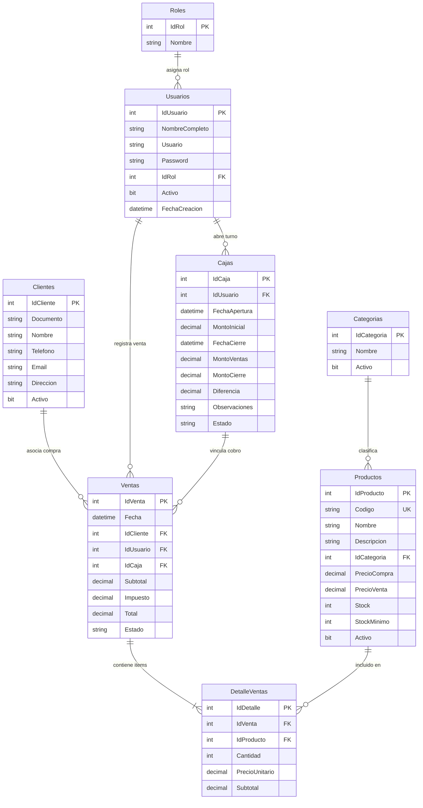

# Sistema de Punto de Venta (POS)

> Sistema POS de escritorio para gestionar productos, inventario, clientes, turnos de caja y ventas, con consultas multi-tabla y persistencia mediante **Entity Framework Core**.

## Integrantes del Equipo de Cátedra

```text
Juan Josué Irias Roque #260708
Kevin Alexander Rivera Escobar #260394
Orlando Josué Benitez Cortez #260534
Christopher Henry Godoy Orellana #260588
```

### ¿Qué hace el sistema?

El POS permite al negocio:
- Administrar el **catálogo de productos**, categorías y control estricto de **inventario** con alertas de stock mínimo.
- Gestionar **clientes** y asociar compras por documento/nombre o venta predeterminada a *Consumidor Final*.
- Controlar **turnos de caja** obligatorios (apertura, registro de fondo inicial, arqueo en tiempo real y cierre con cálculo de diferencias).
- Registrar **ventas** (cabecera + detalle) mediante transacciones atómicas con descuento automático de stock y cálculo de cambio.
- Consultar **historial de ventas, reportes analíticos y KPIs** cruzando múltiples tablas con carga optimizada.

---

### Gestión de productos / inventario
- [x] Alta, edición, consulta y **baja lógica** (mediante el atributo `Activo = 0`).
- [x] Asociación producto $\leftrightarrow$ categoría (`IdCategoria` FK).
- [x] Control de existencias: descuento atómico al vender e impedimento de ventas sin existencias suficientes.
- [x] Alertas visuales de stock mínimo (`Stock <= StockMinimo`).
- [x] Búsqueda interactiva por código (con tecla Enter) y filtrado de catálogo.
- **Validaciones activas:** Código obligatorio y único; Nombre obligatorio; Categoría obligatoria; Precios $\ge 0$; Stock $\ge 0$; Stock Mínimo $\ge 0$.

### Clientes y usuarios
- [x] CRUD de clientes (Documento, Nombre, Teléfono, Email, Dirección).
- [x] Cliente predeterminado *"Consumidor Final"* (Documento `00000000`).
- [x] Autenticación y control de acceso basado en roles (RBAC):
  - **Administrador (`admin` / `admin123`):** Acceso total a mantenimiento de productos, precios, reportes, turnos y ventas.
  - **Cajero (`cajero` / `cajero123`):** Acceso operativo a ventas, apertura/cierre de turno y consultas en modo lectura.

### Control de turnos de caja
- [x] Apertura obligatoria de turno con fondo inicial para habilitar el módulo de cobro.
- [x] Seguimiento continuo de ventas acumuladas por turno en tiempo real.
- [x] Cierre de turno con arqueo físico (monto esperado vs. monto contado) y cálculo de diferencia (exacto, sobrante o faltante).
- [x] Historial de turnos con observaciones y estados (`ABIERTA`, `CERRADA`).

### Registro de ventas y transacciones
- [x] Carrito reactivo con lector de código de barras, atajos `+1`, `-1`, `Quitar` y `Vaciar`.
- [x] Identificador único de transacción autoincremental (`IdVenta` en SQL Server).
- [x] Cobro en efectivo con cálculo dinámico de cambio y validación de importe suficiente.
- [x] Generación y visualización de comprobante digital / ticket.

### Cálculo de totales e impuestos
Fórmula centralizada en `VentaServicio`:
```text
Subtotal  = Σ (Cantidad × PrecioUnitario)
Descuento = $0.00 (precios netos al público)
Impuesto  = $0.00 (precios con IVA incluido; tasa 13% referencial en Constantes)
Total     = Subtotal
Redondeo  = 2 decimales exactos (tipo decimal de C# y decimal(12,2) en SQL Server)
```

### Consultas multi-tabla y analítica
- [x] Historial de ventas con filtros de fecha (Hoy, 7 Días, Mes o rango libre) y cajero.
- [x] Detalle de venta cruzando cabecera, líneas, producto y categoría con `Include`.
- [x] Métricas analíticas KPI: Total ventas, número de transacciones, ticket promedio y artículos vendidos.
- [x] Top 5 productos más vendidos calculados mediante agregaciones LINQ / EF Core.

---

### UI

**La interfaz gráfica se mantiene 100% idéntica:**
- Distribución de formularios, tamaños, fuentes y paleta corporativa Azul Marino (`TemaUI`, `#0F172A`).
- Controles (`DataGridView`, `TextBox`, `Button`, `ComboBox`, `Label`) y orden de tabulación.
- Flujos de interacción: foco automático en código de barras, atajos de teclado y diálogos de confirmación.

**Mapeo de la UI existente:**

| Formulario | Ubicación | Responsabilidad |
|---|---|---|
| `frmLogin.cs` | `Presentacion/frmLogin.cs` | Autenticación y acceso por rol |
| `frmPrincipal.cs` | `Presentacion/frmPrincipal.cs` | Ventana maestra y navegación RBAC |
| `frmVentas.cs` | `Presentacion/frmVentas.cs` | Carrito de venta, validación de turno y cobro |
| `frmProductos.cs` | `Presentacion/frmProductos.cs` | Mantenimiento de catálogo y existencias |
| `frmClientes.cs` | `Presentacion/frmClientes.cs` | Directorio y mantenimiento de clientes |
| `frmCaja.cs` | `Presentacion/frmCaja.cs` | Turnos de caja, fondo inicial, arqueo y cierre |
| `frmReportes.cs` | `Presentacion/frmReportes.cs` | KPIs analíticos, historial y reimpresión |


## Estructura de carpetas y dependencias

```text
PuntoDeVenta/
├── PuntoDeVenta.sln                  # Solución de Visual Studio
├── README.md                         # Documentación oficial y guía de arquitectura
├── MANUAL_DE_USO.md                  # Manual operativo paso a paso
├── LICENSE                           # Licencia MIT
│
├── docs/                             # Documentación de paridad y calidad
│   ├── casos-de-prueba.md            # Casos de prueba y validación sin regresiones
│   └── capturas-ui-referencia/       # Referencia de las 7 pantallas del sistema
│
├── Database/                         # Base de datos SQL Server / LocalDB
│   ├── PuntoDeVentaDB.mdf            # Archivo de base de datos primaria
│   ├── PuntoDeVentaDB_log.ldf        # Archivo de registro de transacciones
│   ├── PuntoDeVentaDB.sql            # Script unificado (BD, tablas, relaciones, semillas)
│   └── scripts/
│       ├── 01_esquema.sql            # Definición DDL (8 tablas, PK, FK, constraints)
│       ├── 02_datos_semilla.sql      # Datos iniciales (roles, usuarios, productos, cliente)
│       └── 03_vistas_consultas.sql   # Vistas analíticas multi-tabla para reportes
│
└── PuntoDeVenta/                     # Proyecto principal (.NET 9 WinForms)
    ├── Program.cs                    # Punto de entrada de la aplicación
    ├── App.config                    # Cadenas de conexión (PuntoDeVentaConn / PuntoDeVentaDB)
    ├── PuntoDeVenta.csproj           # Configuración del proyecto y paquetes NuGet
    │
    ├── Presentacion/                 # Capa de Interfaz de Usuario (UI)
    │   ├── frmLogin.cs
    │   ├── frmPrincipal.cs
    │   ├── frmVentas.cs
    │   ├── frmProductos.cs
    │   ├── frmClientes.cs
    │   ├── frmCaja.cs
    │   └── frmReportes.cs
    │
    ├── Modelos/                      # Entidades del Dominio (Mapeo EF Core)
    │   ├── PosContext.cs             # Contexto DbContext central de Entity Framework Core
    │   ├── Rol.cs
    │   ├── Usuario.cs
    │   ├── Categoria.cs
    │   ├── Producto.cs
    │   ├── Cliente.cs
    │   ├── Caja.cs
    │   ├── Venta.cs
    │   └── DetalleVenta.cs
    │
    ├── Datos/                        # Capa de Acceso a Datos (DAL)
    │   ├── PosContext.cs             # Especialización / alias de acceso a datos
    │   ├── UnidadDeTrabajo.cs        # Coordinador de transacciones y repositorios
    │   └── Repositorios/             # Repositorios tipados
    │       ├── IRepositorio.cs       # Contrato genérico CRUD
    │       ├── ProductoRepositorio.cs
    │       ├── ClienteRepositorio.cs
    │       ├── VentaRepositorio.cs   # Transacciones multi-tabla y consultas con Include
    │       ├── CajaRepositorio.cs
    │       └── UsuarioRepositorio.cs
    │
    ├── Servicios/                    # Capa de Lógica de Negocio (BLL)
    │   ├── ProductoServicio.cs
    │   ├── ClienteServicio.cs
    │   ├── VentaServicio.cs          # Procesamiento de venta, validación y totales
    │   ├── InventarioServicio.cs     # Verificación de stock y alertas
    │   ├── CajaServicio.cs           # Apertura, arqueo y cierre de turnos
    │   └── UsuarioServicio.cs        # Autenticación y roles
    │
    ├── DTOs/                         # Data Transfer Objects
    │   ├── VentaResumenDto.cs        # Proyección optimizada para historial
    │   ├── LineaVentaDto.cs          # Proyección de líneas del carrito
    │   └── ReporteDTO.cs             # DTOs para métricas KPI y top productos
    │
    ├── Validaciones/                 # Reglas comerciales centralizadas
    │   ├── VentaValidador.cs         # Validaciones de venta, carrito y cajero
    │   └── ProductoValidador.cs      # Validaciones de catálogo y stock
    │
    ├── Comun/                        # Utilidades compartidas y transversales
    │   ├── Constantes.cs             # Constantes del sistema, roles y estados
    │   └── Excepciones/              # Excepciones tipadas
    │       ├── NegocioException.cs   # Reglas de negocio incumplidas
    │       └── DatosException.cs     # Errores en infraestructura de datos
    │
    └── Utilidades/                   # Utilitarios de UI y seguridad
        ├── TemaUI.cs                 # Paleta corporativa Azul Marino
        └── Seguridad.cs              # Utilitarios de seguridad
```

### Reglas de dependencia entre capas

```text
Presentacion  →  Servicios  →  Datos  →  Modelos
      │                                     ↑
      └────────────── DTOs ─────────────────┘
```

- `Presentacion` **solo** conoce `Servicios` y `DTOs`.
- `Servicios` contiene la lógica comercial, utiliza `Validaciones` y coordina con `Datos`.
- `Datos` es el **único** componente que interactúa con EF Core y la base de datos.
- `Modelos` define las entidades del dominio sin depender de capas superiores.

### Diagrama Entidad-Relación



### Tablas principales

| Tabla | Propósito | Columnas Clave | Relaciones |
|---|---|---|---|
| `Roles` | Perfiles de seguridad | `IdRol` (PK), `Nombre` | 1:N con `Usuarios` |
| `Usuarios` | Cuentas de cajeros y administradores | `IdUsuario` (PK), `Usuario`, `Password`, `IdRol` (FK) | N:1 con `Roles`, 1:N con `Cajas` y `Ventas` |
| `Categorias` | Familias de productos | `IdCategoria` (PK), `Nombre`, `Activo` | 1:N con `Productos` |
| `Productos` | Catálogo e inventario | `IdProducto` (PK), `Codigo`, `Nombre`, `Stock`, `IdCategoria` (FK) | N:1 con `Categorias`, 1:N con `DetalleVentas` |
| `Clientes` | Directorio de clientes | `IdCliente` (PK), `Documento`, `Nombre` | 1:N con `Ventas` |
| `Cajas` | Turnos y arqueos de caja | `IdCaja` (PK), `IdUsuario` (FK), `MontoInicial`, `MontoVentas`, `Estado` | N:1 con `Usuarios`, 1:N con `Ventas` |
| `Ventas` | Cabecera de transacciones | `IdVenta` (PK), `Fecha`, `IdCliente`, `IdUsuario`, `IdCaja`, `Total` | N:1 con `Clientes`, `Usuarios`, `Cajas`; 1:N con `DetalleVentas` |
| `DetalleVentas` | Líneas de producto vendidas | `IdDetalle` (PK), `IdVenta` (FK), `IdProducto` (FK), `Cantidad`, `Subtotal` | N:1 con `Ventas` y `Productos` |


### Requisitos del sistema
- **Sistema Operativo:** Windows 10 / Windows 11
- **Entorno de desarrollo:** Visual Studio 2022 con la carga de trabajo *Desarrollo de escritorio de .NET* o VS Code con C# DevKit
- **SDK:** .NET 9.0 SDK
- **Base de datos:** SQL Server Express LocalDB (`(localdb)\MSSQLLocalDB`), SQL Server Express o Developer Edition
- 
