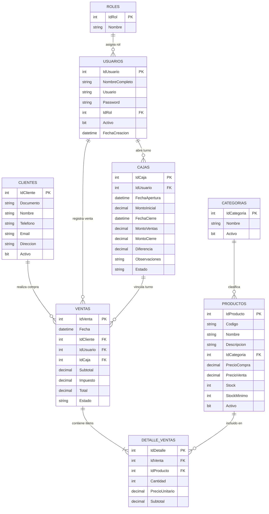

# 🛒 Sistema POS (Punto de Venta) en C# + WinForms + SQL Server

Sistema de punto de venta de escritorio desarrollado con **C#**, **Windows Forms (.NET 9)** y **SQL Server**. Diseñado con una arquitectura desacoplada por capas (N-Tier), con control transaccional de inventario, control de acceso basado en roles (RBAC), control integral de turnos de caja y módulo de reportes analíticos.

---

## 👥 Integrantes del Equipo de Cátedra

```text
Juan Josué Irias Roque #260708
Kevin Alexander Rivera Escobar #260394
Orlando Josué Benitez Cortez #260534
Christopher Henry Godoy Orellana #260588
```

---

## 📑 Tabla de contenido

1. [✨ Características Principales](#-características-principales)
2. [👥 Integrantes del Equipo de Cátedra](#-integrantes-del-equipo-de-cátedra)
3. [🔐 Roles del Sistema y Credenciales](#-roles-del-sistema-y-credenciales)
4. [🏗️ Arquitectura del Software](#️-arquitectura-del-software)
5. [🗄️ Modelo de Base de Datos](#️-modelo-de-base-de-datos)
6. [⚙️ Requisitos e Instalación](#️-requisitos-e-instalación)
7. [🚀 Cómo Ejecutar la Aplicación](#-cómo-ejecutar-la-aplicación)
8. [💻 Código y Seguridad](#-código-y-seguridad)
9. [📖 Manual de Uso](#-manual-de-uso)
10. [🐙 Publicar en GitHub](#-publicar-en-github)
11. [📄 Licencia](#-licencia)

---

## ✨ Características Principales

- 🔐 **Autenticación y Roles (RBAC):** Validación de credenciales de usuario y adaptación dinámica de permisos según el perfil del usuario (Administrador / Cajero).
- 💵 **Control Integral de Caja:** Turnos de caja obligatorios para ventas, captura de fondo inicial, arqueo en tiempo real (monto esperado vs. monto contado) y cálculo automático de diferencias (exacto, sobrante o faltante).
- 🧾 **Módulo de Ventas / Carrito:** Carrito reactivo con lector de código de barras (tecla Enter), acumulación inteligente de existencias, atajos rápidos (+1, -1, quitar, vaciar) y cálculo de cambio.
- 📦 **Control de Inventario Transaccional:** Descuento atómico de existencias mediante transacciones SQL (`SqlTransaction`), soporte para descripción detallada de productos y prevención de ventas sin existencias suficientes.
- 📊 **Historial y Reportes de Ventas:** Visualización de métricas clave (Total ventas, número de transacciones, ticket promedio, artículos vendidos), filtros por fecha (Hoy, 7 Días, Mes) y consulta/reimpresión de tickets.
- 👥 **Gestión de Clientes:** Directorio de clientes para asociar compras por documento/nombre o venta predeterminada a Consumidor Final.
- 🎨 **Diseño Moderno y Unificado (TemaUI):** Interfaz corporativa limpia y profesional con paleta en tonos Azul Marino (#0F172A).

---

## 🔐 Roles del Sistema y Credenciales

El sistema cuenta con dos perfiles de usuario preconfigurados con diferentes privilegios de acceso:

| Rol | Usuario | Contraseña | Permisos y Alcance |
| :--- | :--- | :--- | :--- |
| **Administrador** | `admin` | `admin123` | **Acceso total:** Crear, editar y eliminar productos; administrar precios, descripción y stock; abrir y cerrar turnos de caja; registrar clientes; realizar ventas; consultar reportes analíticos y KPIs. |
| **Cajero** | `cajero` | `cajero123` | **Acceso operativo:** Apertura y cierre de turnos de caja, cobro de ventas, selección de clientes, reimpresión de tickets y consulta de catálogo/precios en modo lectura (edición y eliminación bloqueadas). |

### Matriz de Permisos por Módulo

| Módulo / Acción | Administrador | Cajero |
| :--- | :---: | :---: |
| Iniciar Sesión | ✅ | ✅ |
| Apertura y Cierre de Caja | ✅ | ✅ |
| Registrar y Cobrar Ventas | ✅ | ✅ |
| Consultar Productos y Precios | ✅ | ✅ |
| Agregar Nuevos Productos | ✅ | ❌ *(Solo lectura)* |
| Modificar Precios, Descripción y Stock | ✅ | ❌ *(Solo lectura)* |
| Eliminar Productos | ✅ | ❌ *(Solo lectura)* |
| Administrar Directorio de Clientes | ✅ | ✅ |
| Consultar Historial y Reportes | ✅ | ✅ |

> [!NOTE]
> Las credenciales de acceso por defecto son: **Administrador** (`admin` / `admin123`) y **Cajero** (`cajero` / `cajero123`).

---

## 🏗️ Arquitectura del Software

El proyecto sigue una arquitectura desacoplada por capas (**N-Tier Architecture**) que separa la interfaz visual de las reglas de negocio y el acceso a datos:

```text
PuntoDeVenta/
│
├── PuntoDeVenta.sln                  # Solución de Visual Studio
├── README.md                         # Documentación oficial del sistema
├── MANUAL_DE_USO.md                  # Manual de usuario y flujo operativo
├── LICENSE                           # Licencia de software MIT
├── .gitignore                        # Reglas de exclusión de Git
│
├── Database/                         # Scripts de base de datos SQL Server
│   └── PuntoDeVentaDB.sql            # Script unificado: Creación de BD, tablas, claves foráneas y datos iniciales
│
└── PuntoDeVenta/                     # Proyecto de aplicación (.NET 9 WinForms)
    ├── Presentacion/                 # Capa de Interfaz Gráfica (UI)
    │   ├── frmLogin.cs               # Pantalla de acceso y autenticación
    │   ├── frmPrincipal.cs           # Ventana maestra con menú lateral y control por rol
    │   ├── frmVentas.cs              # Interfaz de cobro, carrito y control de turno
    │   ├── frmProductos.cs           # Catálogo, mantenimiento y descripción de productos
    │   ├── frmClientes.cs            # Directorio y mantenimiento de clientes
    │   ├── frmCaja.cs                # Turnos, apertura, arqueo y cierre de caja
    │   └── frmReportes.cs            # Historial de ventas, métricas KPI y copia de comprobantes
    │
    ├── Negocio/                      # Capa de Lógica de Negocio (BLL)
    │   ├── VentaService.cs           # Reglas de venta, resumen analítico y Top productos
    │   ├── ProductoService.cs        # Reglas de validación de productos y stock
    │   ├── UsuarioService.cs         # Lógica de autenticación y verificación de contraseñas
    │   └── CajaService.cs            # Gestión de turnos, apertura, validación y arqueo
    │
    ├── Datos/                        # Capa de Acceso a Datos (DAL con ADO.NET)
    │   ├── Conexion.cs               # Manejo centralizado de SqlConnection
    │   ├── VentaRepository.cs        # Registro transaccional cabecera-detalle en BD
    │   ├── ProductoRepository.cs     # Operaciones CRUD en tabla Productos
    │   ├── ClienteRepository.cs      # Operaciones CRUD en tabla Clientes
    │   ├── UsuarioRepository.cs      # Consultas y validación de credenciales
    │   └── CajaRepository.cs         # Consultas y transacciones de caja y turnos
    │
    ├── Entidades/                    # Modelos de Datos (DTOs / POCOs)
    │   ├── Producto.cs
    │   ├── Cliente.cs
    │   ├── Venta.cs
    │   ├── DetalleVenta.cs
    │   ├── Caja.cs
    │   ├── ReporteDTO.cs
    │   └── Usuario.cs
    │
    ├── Utilidades/                   # Utilidades del sistema
    │   ├── Seguridad.cs              # Utilitarios de validación y seguridad
    │   └── TemaUI.cs                 # Paleta corporativa Azul Marino y estilos compartidos
    │
    ├── App.config                    # Cadena de conexión activa a SQL Server
    ├── App.config.example            # Plantilla de configuración de conexiones
    └── Program.cs                    # Punto de entrada de la aplicación
```

---

## 🗄️ Modelo de Base de Datos

### Diagrama Entidad-Relación



---

## ⚙️ Requisitos e Instalación

### Requisitos del Sistema
- **Sistema Operativo:** Windows 10 / Windows 11
- **SDK:** .NET 9.0 SDK (o superior)
- **Base de Datos:** SQL Server LocalDB (`(localdb)\MSSQLLocalDB`), SQL Server Express o Developer Edition
- **IDE:** Visual Studio 2022 o Visual Studio Code con C# DevKit

### Configuración de la Base de Datos

El proyecto cuenta con un script SQL unificado que crea la base de datos `PuntoDeVentaDB`, sus 8 tablas, relaciones y datos iniciales:

1. Inicia la instancia de SQL Server LocalDB en tu terminal PowerShell:
   ```powershell
   sqllocaldb start MSSQLLocalDB
   ```
2. Ejecuta el script unificado con `sqlcmd`:
   ```powershell
   sqlcmd -S "(localdb)\MSSQLLocalDB" -E -i "Database\PuntoDeVentaDB.sql"
   ```
   *(También puedes abrir y ejecutar `Database/PuntoDeVentaDB.sql` directamente en SQL Server Management Studio).*

### Cadena de Conexión (`App.config`)

Por defecto, la aplicación apunta a **SQL Server LocalDB**:

```xml
<configuration>
  <connectionStrings>
    <add name="PuntoDeVentaDB"
         connectionString="Server=(localdb)\MSSQLLocalDB;Database=PuntoDeVentaDB;Trusted_Connection=True;TrustServerCertificate=True;"
         providerName="Microsoft.Data.SqlClient" />
  </connectionStrings>
</configuration>
```

> [!TIP]
> Si deseas conectar a una instancia de SQL Server Express instalada localmente, cambia `Server=(localdb)\MSSQLLocalDB;` por `Server=localhost\SQLEXPRESS;`.

---

## 🚀 Cómo Ejecutar la Aplicación

### Opción 1: Desde la Terminal (.NET CLI)
```powershell
dotnet build
dotnet run --project PuntoDeVenta/PuntoDeVenta.csproj
```

### Opción 2: Desde Visual Studio
1. Abre el archivo de solución `PuntoDeVenta.sln`.
2. Presiona `F5` o haz clic en el botón de reproducción (Iniciar) en la barra superior.

---

## 💻 Código y Seguridad

### Registro Transaccional de Ventas (`VentaRepository.cs`)
Para garantizar la integridad y consistencia contable, la venta, el descuento atómico de stock y el vínculo con el turno de caja se ejecutan dentro de una única transacción atómica `SqlTransaction`:

```csharp
using var cn = Conexion.ObtenerConexion();
cn.Open();
using var tx = cn.BeginTransaction();

try
{
    // 1. Inserción de cabecera de la venta vinculada a la caja activa
    var cmdVenta = new SqlCommand(@"
        INSERT INTO Ventas (Fecha, IdCliente, IdUsuario, IdCaja, Subtotal, Impuesto, Total, Estado)
        VALUES (@Fecha, @IdCliente, @IdUsuario, @IdCaja, @Subtotal, @Impuesto, @Total, @Estado);
        SELECT SCOPE_IDENTITY();", cn, tx);
    // ... parámetros ...
    int idVenta = Convert.ToInt32(cmdVenta.ExecuteScalar());

    // 2. Inserción de líneas y descuento atómico de stock
    foreach (var d in detalles)
    {
        var cmdDet = new SqlCommand(@"
            INSERT INTO DetalleVentas (IdVenta, IdProducto, Cantidad, PrecioUnitario, Subtotal)
            VALUES (@IdVenta, @IdProducto, @Cantidad, @PrecioUnitario, @Subtotal);

            UPDATE Productos SET Stock = Stock - @Cantidad
            WHERE IdProducto = @IdProducto AND Stock >= @Cantidad;", cn, tx);
        // ... parámetros ...
        cmdDet.ExecuteNonQuery();
    }

    tx.Commit();
    return idVenta;
}
catch
{
    tx.Rollback();
    throw;
}
```

---

## 📖 Manual de Uso

Para consultar el flujo de trabajo operativo paso a paso (apertura de turno, cobro, arqueo de caja y consulta de reportes), revisa el [Manual de Uso](MANUAL_DE_USO.md).

---

## 🐙 Publicar en GitHub

Para sincronizar o subir cambios al repositorio remoto:

```powershell
git add .
git commit -m "docs: actualizar documentacion con todas las mejoras y roles aplicados"
git push -u origin main
```

---

## 📄 Licencia

Este proyecto está distribuido bajo la licencia [MIT](LICENSE).
