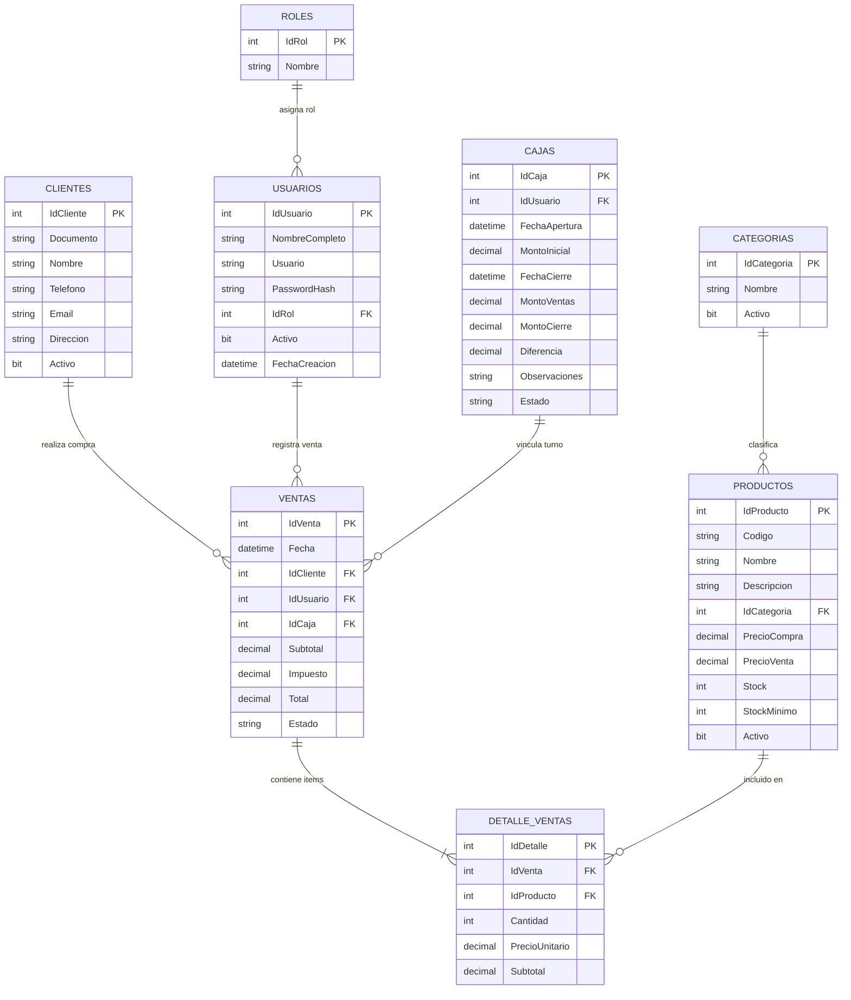

# 🛒 Sistema POS (Punto de Venta) en C# WinForms y SQL Server

Sistema de punto de venta de escritorio desarrollado con **C#**, **Windows Forms (.NET 9)** y **SQL Server**. Diseñado con una arquitectura desacoplada por capas (N-Tier), con control transaccional de inventario, seguridad mediante contraseñas con hash SHA-256 y control de acceso basado en roles (RBAC).


## roles del Sistema y Credenciales


| Rol | Usuario | Contraseña | Permisos y Alcance |
| :--- | :--- | :--- | :--- |
| **Administrador** | `admin` | `admin123` | **Acceso total:** Crear, editar y eliminar productos; modificar precios y existencias; gestionar clientes; realizar ventas; consultar reportes y configuración. |
| **Cajero** | `cajero` | `cajero123` | **Acceso operativo:** Apertura de caja, registro de ventas, escaneo de productos, selección de clientes y consulta de catálogo/precios (edición y eliminación bloqueadas). |

### Matriz de Permisos por Módulo

| Módulo / Acción | Administrador | Cajero |
| :--- | :---: | :---: |
| Iniciar Sesión | ✅ | ✅ |
| Apertura y Cierre de Caja | ✅ | ✅ |
| Registrar y Cobrar Venta | ✅ | ✅ |
| Consultar Productos y Precios | ✅ | ✅ |
| Agregar Nuevos Productos | ✅ | ❌ (Solo lectura)*|
| Modificar Precios, Descripción y Stock | ✅ | ❌ (Solo lectura) |
| Eliminar Productos | ✅ | ❌ (Solo lectura) |
| Administrar Clientes | ✅ | ✅ |
| Consultar Historial y Reportes | ✅ | ✅ |

---

## 🏗️ Arquitectura

```text
PuntoDeVenta/
│
├── PuntoDeVenta.sln                  # Solución de Visual Studio
├── README.md                         # Documentación oficial
├── MANUAL_DE_USO.md                  # Manual de usuario paso a paso
├── LICENSE                           # Licencia MIT
├── .gitignore                        # Reglas de exclusión de Git
│
├── Database/                         # Script unificado de base de datos SQL Server
│   └── PuntoDeVentaDB.sql            # Creación de BD, tablas, claves y datos semilla
│
└── PuntoDeVenta/                     # Proyecto de aplicación (.NET 9 WinForms)
    ├── Presentacion/                 # Capa de Interfaz Gráfica (UI)
    │   ├── frmLogin.cs               # Pantalla de acceso y autenticación
    │   ├── frmPrincipal.cs           # Ventana maestra con menú lateral y control por rol
    │   ├── frmVentas.cs              # Interfaz de cobro, carrito y acumulación de stock
    │   ├── frmProductos.cs           # Mantenimiento, catálogo de productos y descripción
    │   ├── frmClientes.cs            # Mantenimiento de clientes
    │   ├── frmCaja.cs                # Apertura, cierre y arqueo de turnos de caja
    │   └── frmReportes.cs            # Historial de ventas, KPIs y Top productos
    │
    ├── Negocio/                      # Capa de Lógica de Negocio (BLL)
    │   ├── VentaService.cs           # Validaciones de ventas y despacho de transacciones
    │   ├── ProductoService.cs        # Reglas de validación de productos y stock
    │   ├── UsuarioService.cs         # Lógica de autenticación y hash de contraseñas
    │   └── CajaService.cs            # Lógica de apertura, cierre y arqueo de caja
    │
    ├── Datos/                        # Capa de Acceso a Datos (DAL con ADO.NET)
    │   ├── Conexion.cs               # Manejo centralizado de SqlConnection
    │   ├── VentaRepository.cs        # Registro transaccional cabecera-detalle en BD
    │   ├── ProductoRepository.cs     # Operaciones CRUD en tabla Productos
    │   ├── ClienteRepository.cs      # Operaciones CRUD en tabla Clientes
    │   ├── UsuarioRepository.cs      # Consultas y validación de credenciales
    │   └── CajaRepository.cs         # Consultas y transacciones de caja y turnos
    │
    ├── Entidades/                    # Modelos de Datos (DTOs / POCOs)
    │   ├── Producto.cs
    │   ├── Cliente.cs
    │   ├── Venta.cs
    │   ├── DetalleVenta.cs
    │   ├── Caja.cs
    │   ├── ReporteDTO.cs
    │   └── Usuario.cs
    │
    ├── Utilidades/                   # Utilitarios
    │   └── Seguridad.cs              # Generación y verificación de hash SHA-256
    │
    ├── App.config                    # Cadena de conexión activa a SQL Server
    └── Program.cs                    # Punto de entrada de la aplicación
```

---

##  Modelo de Base de Datos



---

## ⚙️ Instalación y Ejecución

Ejecuta el script unificado en tu instancia de SQL Server (por ejemplo, en LocalDB):

