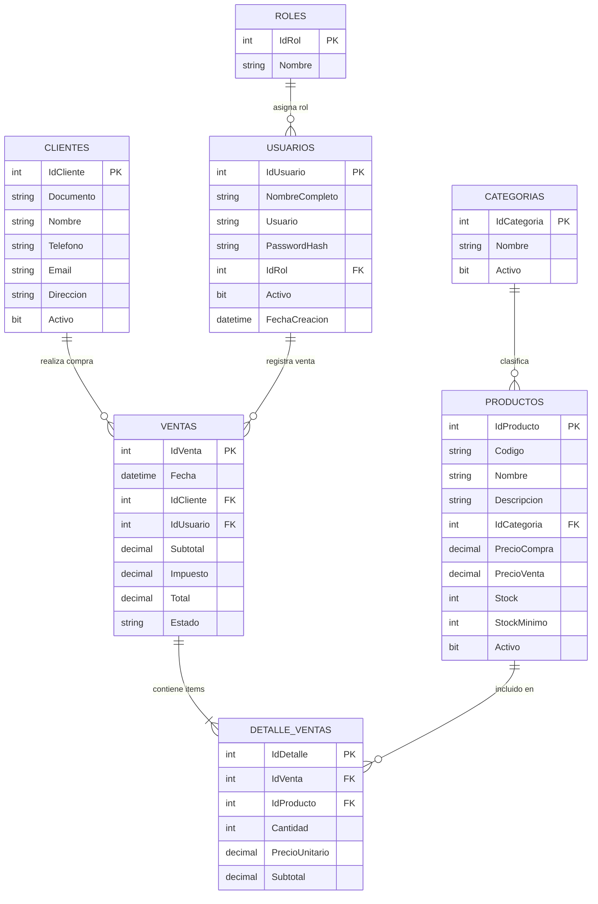

# 🛒 Sistema POS (Punto de Venta) en C# + WinForms + SQL Server

Sistema de punto de venta de escritorio desarrollado con **C#**, **Windows Forms (.NET 9)** y **SQL Server**. Diseñado con una arquitectura desacoplada por capas (N-Tier), con control transaccional de inventario, seguridad mediante contraseñas con hash SHA-256 y control de acceso basado en roles (RBAC).

---

## 📑 Tabla de contenido

1. [✨ Características Principales](#-características-principales)
2. [👥 Roles del Sistema y Credenciales](#-roles-del-sistema-y-credenciales)
3. [🏗️ Arquitectura del Software](#️-arquitectura-del-software)
4. [🗄️ Modelo de Base de Datos](#️-modelo-de-base-de-datos)
5. [⚙️ Requisitos e Instalación](#️-requisitos-e-instalación)
6. [🚀 Cómo Ejecutar la Aplicación](#-cómo-ejecutar-la-aplicación)
7. [💻 Código y Seguridad](#-código-y-seguridad)
8. [🐙 Publicar en GitHub](#-publicar-en-github)
9. [📄 Licencia](#-licencia)

---

## ✨ Características Principales

- 🔐 **Autenticación y Roles:** Validación de credenciales cifradas con SHA-256 y adaptación de la interfaz según el rol del usuario (Administrador / Cajero).
- 🧾 **Módulo de Ventas / Caja:** Carrito de compras en tiempo real, lector de código de barras por teclado (tecla Enter), cálculo automático de Subtotal, Impuesto (16%) y Total.
- 📦 **Control de Inventario Transaccional:** Descuento atómico de stock mediante transacciones SQL (`SqlTransaction`), previniendo inconsistencias o ventas sin existencia.
- 👥 **Gestión de Clientes:** Directorio de clientes para asociar ventas o ticket a Consumidor Final.
- 🔌 **Tolerancia y Resiliencia:** Verificador de conectividad con SQL Server y modo de respaldo offline simulado si la base de datos no está disponible.

---

## 👥 Roles del Sistema y Credenciales

El sistema cuenta con dos perfiles de usuario preconfigurados con diferentes privilegios de acceso:

| Rol | Usuario | Contraseña | Permisos y Alcance |
| :--- | :--- | :--- | :--- |
| **Administrador** | `admin` | `admin123` | **Acceso total:** Crear, editar y eliminar productos; modificar precios y existencias; gestionar clientes; realizar ventas; consultar reportes y configuración. |
| **Cajero** | `cajero` | `cajero123` | **Acceso operativo:** Apertura de caja, registro de ventas, escaneo de productos, selección de clientes y consulta de catálogo/precios (edición y eliminación bloqueadas). |

### Matriz de Permisos por Módulo

| Módulo / Acción | Administrador | Cajero |
| :--- | :---: | :---: |
| Iniciar Sesión | ✅ | ✅ |
| Registrar y Cobrar Venta | ✅ | ✅ |
| Consultar Productos y Precios | ✅ | ✅ |
| Agregar Nuevos Productos | ✅ | ❌ *(Solo lectura)* |
| Modificar Precios y Stock | ✅ | ❌ *(Solo lectura)* |
| Eliminar Productos | ✅ | ❌ *(Solo lectura)* |
| Administrar Clientes | ✅ | ✅ |

> [!NOTE]
> Las contraseñas se almacenan en la tabla `Usuarios` como un hash **SHA-256** en formato hexadecimal en minúsculas. Nunca se guardan contraseñas en texto plano.

---

## 🏗️ Arquitectura del Software

El proyecto sigue una estructura limpia por capas (**N-Tier Architecture**) que separa la interfaz visual de las reglas del negocio y el acceso a datos:

```text
PuntoDeVenta/
│
├── PuntoDeVenta.sln                  # Solución de Visual Studio
├── README.md                         # Documentación oficial
├── LICENSE                           # Licencia MIT
├── .gitignore                        # Reglas de exclusión de Git
│
├── Database/                         # Scripts de base de datos SQL Server
│   ├── 01_CreateDatabase.sql         # Script 1: Creación de BD PuntoDeVentaDB
│   ├── 02_CreateTables.sql           # Script 2: Creación de tablas y claves foráneas
│   └── 03_SeedData.sql               # Script 3: Inserción de roles, usuarios y catálogo
│
└── PuntoDeVenta/                     # Proyecto de aplicación (.NET 9 WinForms)
    ├── Presentacion/                 # Capa de Interfaz Gráfica (UI)
    │   ├── frmLogin.cs               # Pantalla de acceso y comprobación de conexión
    │   ├── frmPrincipal.cs           # Ventana maestra con menú lateral y control por rol
    │   ├── frmVentas.cs              # Interfaz de cobro y carrito de compras
    │   ├── frmProductos.cs           # Mantenimiento y catálogo de productos
    │   └── frmClientes.cs            # Mantenimiento de clientes
    │
    ├── Negocio/                      # Capa de Lógica de Negocio (BLL)
    │   ├── VentaService.cs           # Validaciones de ventas y despacho de transacciones
    │   ├── ProductoService.cs        # Reglas de validación de productos y stock
    │   └── UsuarioService.cs         # Lógica de autenticación y hash de contraseñas
    │
    ├── Datos/                        # Capa de Acceso a Datos (DAL con ADO.NET)
    │   ├── Conexion.cs               # Manejo centralizado de SqlConnection
    │   ├── VentaRepository.cs        # Registro transaccional cabecera-detalle en BD
    │   ├── ProductoRepository.cs     # Operaciones CRUD en tabla Productos
    │   ├── ClienteRepository.cs      # Operaciones CRUD en tabla Clientes
    │   └── UsuarioRepository.cs      # Consultas y validación de credenciales
    │
    ├── Entidades/                    # Modelos de Datos (DTOs / POCOs)
    │   ├── Producto.cs
    │   ├── Cliente.cs
    │   ├── Venta.cs
    │   ├── DetalleVenta.cs
    │   └── Usuario.cs
    │
    ├── Utilidades/                   # Utilitarios
    │   └── Seguridad.cs              # Generación y verificación de hash SHA-256
    │
    ├── App.config                    # Cadena de conexión activa a SQL Server
    ├── App.config.example            # Plantilla de configuración de conexiones
    └── Program.cs                    # Punto de entrada de la aplicación
```

---

## 🗄️ Modelo de Base de Datos

### Diagrama Entidad-Relación



---

## ⚙️ Requisitos e Instalación

### Requisitos del Sistema
- **Sistema Operativo:** Windows 10 / Windows 11
- **SDK:** .NET 9.0 SDK (o superior)
- **Base de Datos:** SQL Server LocalDB (`(localdb)\MSSQLLocalDB`), SQL Server Express o SQL Server Developer Edition.
- **IDE:** Visual Studio 2022 o Visual Studio Code con C# DevKit.

### Configuración de la Base de Datos

1. Abre tu terminal o **SQL Server Management Studio (SSMS)**.
2. Ejecuta los scripts ubicados en la carpeta `Database/` en el siguiente orden:
   ```powershell
   sqlcmd -S "(localdb)\MSSQLLocalDB" -E -i "Database\01_CreateDatabase.sql"
   sqlcmd -S "(localdb)\MSSQLLocalDB" -E -i "Database\02_CreateTables.sql"
   sqlcmd -S "(localdb)\MSSQLLocalDB" -E -i "Database\03_SeedData.sql"
   ```

### Cadena de Conexión (`App.config`)

Por defecto, la aplicación apunta a **SQL Server LocalDB**:

```xml
<configuration>
  <connectionStrings>
    <add name="PuntoDeVentaDB"
         connectionString="Server=(localdb)\MSSQLLocalDB;Database=PuntoDeVentaDB;Trusted_Connection=True;TrustServerCertificate=True;"
         providerName="Microsoft.Data.SqlClient" />
  </connectionStrings>
</configuration>
```

> [!TIP]
> Si deseas conectar a una instancia de SQL Server Express instalada localmente, cambia `Server=(localdb)\MSSQLLocalDB;` por `Server=localhost\SQLEXPRESS;`.

---

## 🚀 Cómo Ejecutar la Aplicación

Tienes 3 alternativas disponibles:

### Opción 1: Acceso Directo de Escritorio (Recomendado)
Haz doble clic sobre el archivo:
```text
C:\Users\finneh\Desktop\Iniciar_PuntoDeVenta.bat
```

### Opción 2: Desde la Terminal (.NET CLI)
```powershell
cd C:\Users\finneh\Desktop\PuntoDeVenta\PuntoDeVenta
dotnet run
```

### Opción 3: Desde Visual Studio
1. Abre el archivo de solución `PuntoDeVenta.sln`.
2. Presiona `F5` o haz clic en el botón de reproducción en la barra de herramientas.

---

## 💻 Código y Seguridad

### Registro Transaccional de Ventas (`VentaRepository.cs`)
Para garantizar la integridad y evitar ventas sin stock suficiente, la venta y la reducción de inventario se ejecutan dentro de una única transacción atómica:

```csharp
using var cn = Conexion.ObtenerConexion();
cn.Open();
using var tx = cn.BeginTransaction();

try
{
    // 1. Inserción de cabecera de la venta
    var cmdVenta = new SqlCommand(@"INSERT INTO Ventas ...", cn, tx);
    int idVenta = Convert.ToInt32(cmdVenta.ExecuteScalar());

    // 2. Inserción de líneas y descuento de stock
    foreach (var d in detalles)
    {
        var cmdDet = new SqlCommand(@"
            INSERT INTO DetalleVentas ...;
            UPDATE Productos SET Stock = Stock - @Cantidad
            WHERE IdProducto = @IdProducto AND Stock >= @Cantidad;", cn, tx);
        
        int afectadas = cmdDet.ExecuteNonQuery();
        if (afectadas < 2)
            throw new InvalidOperationException("Stock insuficiente.");
    }

    tx.Commit();
    return idVenta;
}
catch
{
    tx.Rollback();
    throw;
}
```

---

## 🐙 Publicar en GitHub

Para subir este proyecto a tu perfil de GitHub:

1. Crea un repositorio vacío en [github.com/new](https://github.com/new) con el nombre **PuntoDeVenta** (sin añadir README, .gitignore ni licencia, ya que el proyecto local ya los incluye).
2. Abre PowerShell en la carpeta del proyecto y ejecuta los siguientes comandos:

```powershell
cd "C:\Users\finneh\Desktop\PuntoDeVenta"
git remote add origin https://github.com/MinniFinnex/PuntoDeVenta.git
git push -u origin main
```

---

## 📄 Licencia

Este proyecto está distribuido bajo la licencia [MIT](LICENSE).
